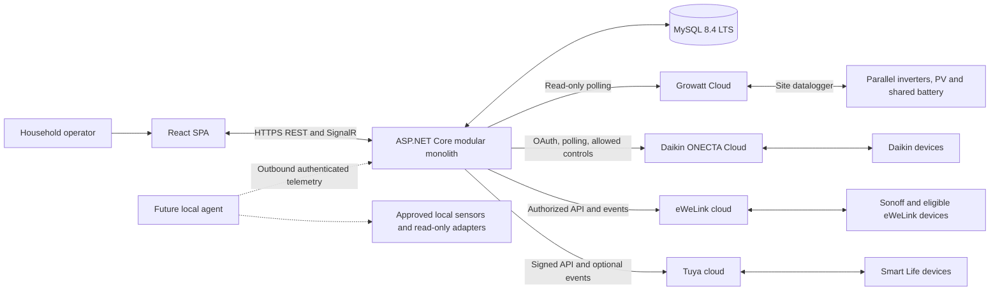

# System overview

Build a property-scoped monitoring and control platform. The first deployment covers a countryside house with two parallel Growatt SPF 5000 ES inverters, PV panels, a shared 51.2 V 200 Ah LiFePO4 battery with BMS communication, Daikin ONECTA air conditioners, and smart devices managed through eWeLink and Smart Life, including Sonoff hardware. Model each inverter and the logical solar installation independently. Use the same device and telemetry model for additional properties and ecosystems.

## Scope and operating assumptions

- Operators can group devices by property and room and see their capabilities, current and historical readings, freshness, connectivity, faults and protection states. Authorized operators can request supported HVAC and switching actions and see their outcomes.
- Add switch and appliance energy monitoring, room temperature and humidity sensors, and scheduled or solar-surplus water heating in later phases. A device can expose several capabilities through one inventory record even when it has multiple connections. The same model can accommodate lights, plugs, contact and motion sensors, and thermostats as those capabilities are added.
- Backend rules run on telemetry and schedules, support overrides and simulation, and record decisions. Record outage, restoration, low SOC, faults, offline transitions, and automation failures as alert events. External notification delivery comes later.
- Start with a single household and a small set of invited users. Each deployment runs one backend instance and one MySQL database. Properties are the access boundary within a deployment. Device data, commands, rules, and subscriptions carry property scope from the start.
- Start with a simulated monitoring milestone. Add supported cloud adapters independently as account access becomes available. Growatt and BMS access is read-only in the initial design. The Growatt account currently has ShinePhone access without an API token. Validate installed models, capabilities, trustworthy grid detection, and the property's timezone before enabling dependent controls.

## System context

| Component | Responsibility |
| --- | --- |
| React SPA | Property dashboard, history, device controls, rules, overrides and audit views. |
| Web API and SignalR | Authenticate, authorize, query durable state, accept commands and push compact change events. |
| Hosted workers | Poll or subscribe to providers, normalize and persist observations, evaluate rules, dispatch and verify commands, aggregate history and maintain alerts. |
| Provider adapters | Translate vendor contracts and capabilities. Provide simulation and later local adapters through the same application ports. |
| MySQL | System of record for inventories, telemetry, reported and desired state, pending work and audit records. |

## Quality goals and constraints

- **Reliability.** Polling and automation run while browsers are closed. Partial provider failures degrade the affected property or capability. Internet loss leaves cloud operations unavailable, with last-known values visibly aged. Restart recovery restores durable work and reconciles uncertain writes.
- **Safety.** Trustworthy observations and supported device limits govern dispatch. Keep reported state, requested state, communication health, measurement freshness, and faults distinct. Preserve circuit, thermostat, thermal, BMS and frost protections. Network-controlled relays provide operational control. Cloud visibility and actuation latency depend on source cadence, connectivity and quotas.
- **Security and operability.** Separate property access and privileges, keep secrets server-side, and audit decisions and commands. Use a single Docker Compose topology for cloud and self-hosting, with tested database and key recovery.
- **Maintainability.** Keep meaningful module boundaries and use MySQL transactions for invariants. Add infrastructure when measured demand or offline requirements justify it. Roll out from simulation to read-only monitoring, manual control, dry-run evaluation and bounded live automation.

## Architecture guide

- [Backend](02-backend-architecture.md) and [frontend](03-frontend-architecture.md)
- [Data model](04-data-model.md) and [integrations](05-integrations.md)
- [Automation](06-automation-engine.md), [security and deployment](07-security-deployment.md), and [roadmap](08-implementation-roadmap.md)
- Decisions on [deployment shape](adr/0001-modular-monolith.md), [web rendering](adr/0002-react-spa.md), [persistence](adr/0003-mysql-dapper.md), [integration locality](adr/0004-cloud-first-integrations.md), [automation execution](adr/0005-automation-execution.md), and [telemetry lifecycle](adr/0006-telemetry-storage.md)
- [Capability model and multiple provider bindings](adr/0007-device-capabilities-and-provider-bindings.md)
