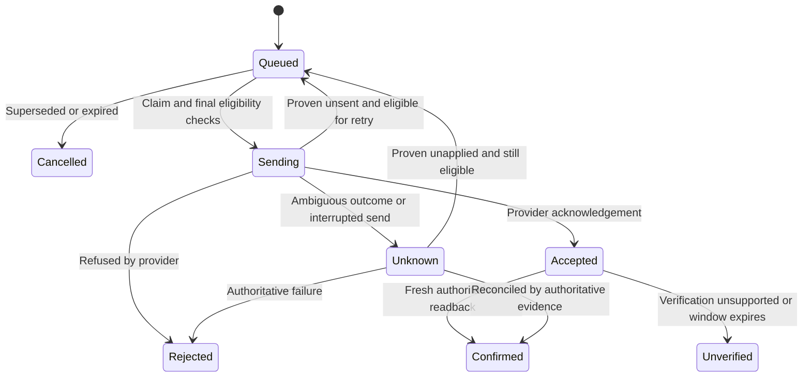

# Automation engine

Use declarative, versioned rules with a fixed catalog of triggers, predicates and actions. Evaluate them inside the backend against timestamped inputs. Send all resulting device writes through the same durable command path used by manual control. See [ADR 0005](adr/0005-automation-execution.md).

## Rule and schedule model

| Element | Design |
| --- | --- |
| Definition | Property, version, enabled state, mode (disabled, dry-run or live), priority and target scope. Validate metric types, units, supported capabilities and safe parameter ranges when saving and enabling. |
| Triggers | Relevant metric/state changes, threshold crossings, property-local schedules, and due delays. Add reevaluation on freshness expiry, override release and meaningful recovery. |
| Conditions | Typed comparisons and boolean groups evaluated as true, false or unknown. Each relevant input carries observed time, quality, source and freshness. Missing, stale or conflicting required inputs prevent dispatch. |
| Actions | Desired state for a stable device endpoint or a domain alert. Use versioned allowlisted actions such as `SetSwitch(on/off)` and heating setpoint changes. Validate access, freshness, site policy and capability constraints before queuing and again at dispatch. |
| Runtime | Persist hysteresis latches, scheduled occurrence identities, pending deadlines and cooldown state. Record triggers, input values/quality or stable evidence references, rule version, proposals, suppression reasons, and command linkage. |

Use `TimeProvider` for elapsed and simulated time and store all due instants in UTC. Interpret calendar schedules in the property's IANA zone. Proposed DST policy is to skip nonexistent wall-clock times and run an ambiguous local occurrence once at its first occurrence in UTC. Persist the occurrence identity and UTC instant. After downtime reconcile the current desired state and skip expired or missed occurrences by default. Replays for explicitly enabled rule types require a freshness check and deadline. Persist delays as due work with their rule version and expiry, then recheck the rule before acting. Separate on/off or entry/exit thresholds implement hysteresis. Start cooldowns from a verified change or a defensible upper bound on when it took effect. Enforce minimum runtime and restart limits for power-changing actions independently. Suppress dependent actions when their timing cannot be established safely.

Rules select observations by canonical device endpoint, capability and metric. A room sensor can trigger an approved HVAC action regardless of which adapter produced the reading. Model cross-provider actions as individual intents with independent outcomes. If safety requires a confirmed preceding state, block the dependent action until it is observed. Begin with forms for the approved rule types and operators.

## Evaluation, arbitration and dispatch

1. Commit accepted relevant transitions, current state and durable evaluation work together. Evaluate one property at a time against a consistent current snapshot, plus the triggering event where a rule needs an edge. Late history and replay cannot manufacture a live transition. Use stable trigger identities so retries do not produce new intents. Commit evaluations, runtime updates and winning intents together. Dry-run and live evaluation have distinct runtime state.
2. Apply capability, safety and live-control checks before arbitration. Hard safety limits and commissioned lockouts take precedence. A valid manual override then takes precedence over automatic rules for its scope. Among eligible rules use higher configured priority, then a stable rule ID for ties, and record the losing proposals. Resolve conflicting targets by endpoint and shared control group. Where a site-wide load budget applies, reserve capacity before allowing concurrent changes and retain it while a load may still be on.
3. An override has a device, endpoint or control-group scope, actor, version and expiry or explicit release. Manual requests update the override and intent transactionally. On expiry or release, reevaluate current inputs. Merge matching command readbacks into the same reported transition. Surface external changes as deviations and suspend repeated correction of protected loads pending review. Inventory existing vendor timers and scenes during commissioning to avoid two automation owners.
4. Skip equivalent active intents and verifiably satisfied targets. Before issuing a command, serialize by physical device and check the latest desired and mapping versions, override, telemetry, expiry, pause state and provider budget. Select one eligible binding and store the attempt before network I/O. Linearize the claim with manual changes using a short transaction and keep the call outside it. A subsequent override can cancel queued work. An already claimed call may take effect, so reconcile before issuing a conflicting successor or trying another route.

Use a stable intent ID across attempts. An unknown send blocks conflicting writes for the device until authoritative reconciliation or an audited operator resolution. A mismatched immediate read is insufficient proof that an eventually consistent provider did not apply a write. If the verification deadline passes, surface the uncertainty and stop active retries. An unverified acknowledgement remains visible and suppresses equivalent resends. Keep reported and desired state separate and document provider delays in the UI. After restart, reload overrides, cooldowns and deadlines, classify interrupted sends as unknown, check fresh device state, and reevaluate eligible work before enabling dispatch. Provider disconnection expires old intents according to their deadline. Recovery evaluates fresh state before creating new ones.

## Reference rule set for an unoccupied property

Model grid evidence as available, outage or unknown, with candidate loss and recovery timers. Only trusted, fresh AC-input or independent grid measurements advance a candidate. Agreement across the required evidence and gaps within the source's tolerated cadence are prerequisites for confirmation. Unknown interrupts continuity and retains the last confirmed state for context. A newly fetched historical sample cannot establish recovery. The five-minute recovery period is a minimum from trustworthy evidence. A slower cloud feed can lengthen recovery or make the rule unsuitable for live use.

| Situation | Proposed configurable behavior |
| --- | --- |
| Grid confirmed available, property unoccupied | Request the validated heating setpoint of 16 °C, subject to current mode and safety policy. |
| Outage confirmed, property unoccupied | Request 10 °C only if the device supports it in heating mode and the approved frost and battery policy allows it. Otherwise suppress the action and record the reason. |
| Grid returns | Restore 16 °C after at least five minutes of verified stable recovery, with fresh evidence and no active override. |
| Manual arrival | An authorized user requests 21–22 °C within the device's allowed range. The override remains active through outage and recovery until expiry or release, subject to hard safety limits. |
| Grid, indoor temperature, or required SOC unknown | Suppress dependent discretionary control, retain last confirmed state for display, and record an alert. Do not start or complete a recovery timer from Internet or provider reconnection alone. |
| Low reserve, prolonged outage, or freezing risk | Use commissioned SOC enter/exit thresholds and a separate approved temperature policy. If conditions give conflicting constraints or remote control is unavailable, suppress discretionary commands, record the incident and rely on independent local protection and the operator's site plan. |

These values are example configuration. Before enabling the rule, demonstrate the actual control and readback path, verify battery limits and frost protection, and define site-specific fallback behavior. A Daikin unit that is offline, loses power or loses cloud connectivity may be unreachable, even if the backend is healthy.

## Solar-surplus water heating

Configure the heater as a commissioned controlled load on a specific switch endpoint. A schedule defines an allowed operating window. A scheduled-only rule may request operation inside that window and under the same restrictions. A surplus rule additionally requires fresh, trusted PV, site-load and battery readings, an approved battery reserve and confirmed grid availability for the first live rule. Estimate usable surplus from the commissioned power balance, accounting for other loads, battery charging obligations and inverter headroom. For continuation, account for the heater's own draw once so its start does not immediately cause its own stop. An absent export reading or zero grid import alone is insufficient evidence of surplus.

| Situation | Rule behavior |
| --- | --- |
| Before start | Verify that the load is off, the on threshold and SOC start threshold have held for the configured dwell, the minimum off time has elapsed, and the authorized window and load budget allow operation. Use commissioned load demand when live appliance power is unavailable. |
| During operation | Request OFF when surplus or reserve crosses its lower stop threshold for the configured dwell. Respect minimum on time for ordinary surplus changes. A protection report, lockout, maximum-runtime deadline, window end or hard reserve limit takes precedence. Persist the deadline before a start attempt using the earliest possible energization time. Keep that deadline fixed across duplicate ON requests and overrides. |
| Data stale or provider unreachable | Suppress new starts. For an active or uncertain run, evaluate the commissioned stop policy and raise an incident. Request OFF only through the approved path when safe, then reconcile. If a prior ON may still arrive, the route must establish ordering or reconciliation before a successor can be relied on. Use the independent local cutoff and manual isolation procedure when network control is unavailable or unknown. |
| Restart or external switching | Reconcile current reported state and the retained deadline before enabling another cycle. Reevaluate an overdue stop promptly when the route can be used safely. If a load is reported on and its start is unknown, treat the run as out of policy and surface it for the approved stop procedure. Skip missed starts and keep unexpected energization visible. |

Enable unattended operation only after verifying relay suitability, local independent limits and shutdown behavior against the [electrical controls criteria](07-security-deployment.md). Relay readback reports switch state. Commission physical load evidence separately where available. Application deadlines and remote OFF attempts are operational controls.

## Room sensors and energy views

- Temperature rules select a commissioned room sensor and maximum measurement age, use separate thresholds and dwell for unusual temperatures, and can record an alert or propose an allowed HVAC action. Use humidity or battery level only when exposed. Stale readings suppress dependent control, and repeated events open at most one active incident for the same condition.
- Build energy views from authoritative household, PV and battery series and separate appliance series. Calculate changes over compatible periods using the [measurement boundaries and energy rules](04-data-model.md). Keep chart totals separate from the shorter-lived, validated power evidence used for surplus control.

## Simulation and acceptance checks

Run the same evaluator over synthetic or recorded observations using simulated time. Return a timeline showing winners, suppressed actions and reasons. Offline simulation uses isolated state. Live dry-run may persist its own evaluation history and checkpoints, with all device and notification writes disabled. Test threshold equality, stale and out-of-order data, five-minute recovery, restart mid-delay and mid-send, competing rules, override races, unsupported setpoint and DST transitions. For heater rules test SOC drops, duplicate local/cloud events, surplus after start, offline deadline, unknown sends, manual lockout and vendor-side changes. Compare dry-run results with observed site events before enabling a single device rule.
